# Gişe

**English** · [Türkçe](README.tr.md)

Ticketing for concerts, plays and festivals, built for the moment a sale opens. Organizers draw their venue's floor plan and put events on sale. Buyers pick seats on the map, and the seats are held for a few minutes while they pay. A busy sale can open with a waiting room that lets people in at a steady pace, in a fair order. Payment happens on the provider's page and is settled by a signed webhook. Tickets are QR codes signed with a private key, so the gate can tell a real ticket from a forged one without a connection. Scans made offline are synced later, and a ticket used at two gates is reported.

[](https://github.com/Beratoguzhan620/gise/actions/workflows/ci.yml)


## Try it

```bash
docker compose up --build
```

This starts PostgreSQL, the API, a stand-in payment provider, Mailpit and nginx with the web app. Open http://localhost:8080 and create an account. Under *Sell tickets*, create an organizer and a venue; the venue form starts with a sample floor plan. Then create an event and publish it. Buy tickets from another browser window. The payment page belongs to the stand-in provider: it asks for no card, only "pay" or "decline". The tickets email, with the PDF attached, arrives in Mailpit at http://localhost:8025. To check tickets, open the event's *Gate*, which also works with the connection off.

- API reference: http://localhost:8080/scalar
- The camera scanner needs HTTPS on a phone (browsers only allow cameras and signature checks on secure pages). On the computer, localhost works, and codes can also be pasted.

## Features

- **Organizers and their teams:** anyone with an account can create an organizer. Staff check tickets at the gate, managers also run venues, events, sales and refunds, owners also manage the team. Membership and role are read from the database on every request.
- **Venues and floor plans:** sections in order from the stage, seated (rows of numbered seats) or standing (a capacity), up to 50,000 places. Events copy the plan when they are published, so editing a venue later never moves a sold seat.
- **Events:** drafts that only the team sees; price categories in kuruş; every section priced; sales opening at a set time; a ticket limit per buyer; buyer refunds until a set time before the start, or only through the organizer.
- **A seat map that never oversells:** buyers pick seats, or a number of standing places. Either every place asked for is taken or none is, and a seat someone else took a moment ago is named. Held places come back by themselves when time runs out.
- **Waiting room:** for sales that sell out in minutes. Everyone who arrives before opening gets a random place in line, so refreshing at the right second earns nothing. Later arrivals queue in order. The line moves at the event's pace, shows each person their number and wait, and gives them a fixed time to choose once it is their turn.
- **Payments:** checkout creates the order and sends the buyer to the provider's page. The order is settled by the provider's signed webhook, acted on once even when it is delivered twice. If a webhook is lost, a background sweep asks the provider. A payment that arrives after its seats went to someone else is refunded automatically. The provider sits behind an interface; a sandbox provider is included.
- **Refunds and cancellation:** buyers refund until the deadline, organizers at any time. Cancelling an event refunds every paid order. Seats go back on sale and tickets stop working at once; the money follows when the provider confirms, retried until it does.
- **Tickets:** one per place, as a QR code signed with ECDSA P-256. They are shown in the app, which works offline, and emailed with a PDF that has one page per ticket. Emails go through an outbox and are retried.
- **Gate:** a device downloads the event's public key and ticket list, then checks codes with the camera or by hand, online or off. Offline scans are queued and synced. The first scan of a ticket wins; repeats and tickets let in twice across gates are reported. The organizer sees who is in, by gate.
- **Organizer's dashboard:** tickets sold by category, takings and refunds, sales by day, orders with search and refunds, and the gate.
- **Web app:** React and TypeScript. The catalog, the seat map with a live basket, the waiting room, the order and tickets, the organizer's area with a floor plan editor, and the gate scanner. Empty, loading and error states throughout, and a phone layout.

## Screenshots

| The seat map, three places chosen | Held while paying |
|---|---|
| 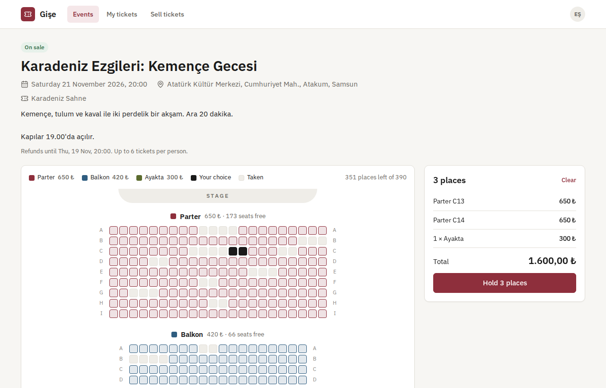 | 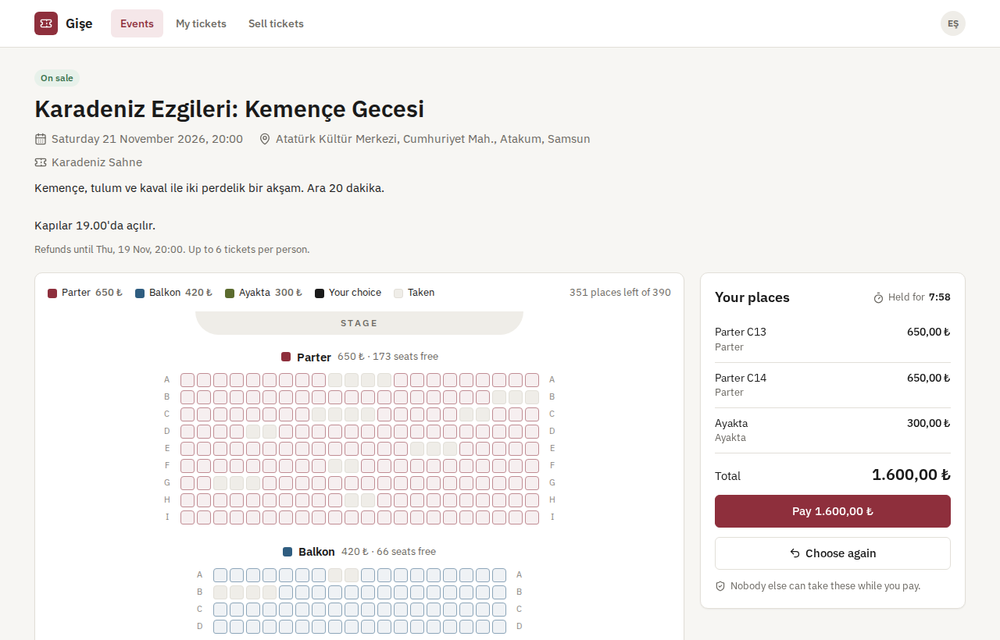 |
| **The provider's payment page (sandbox)** | **Paid: the tickets** |
| 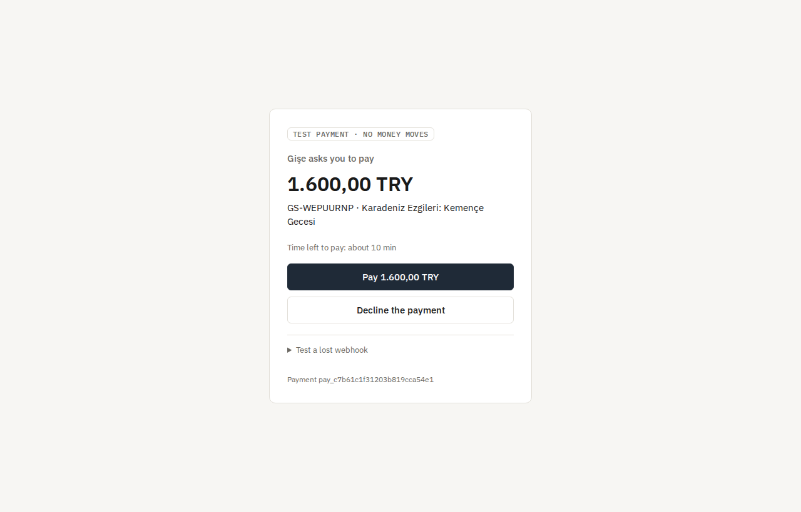 | 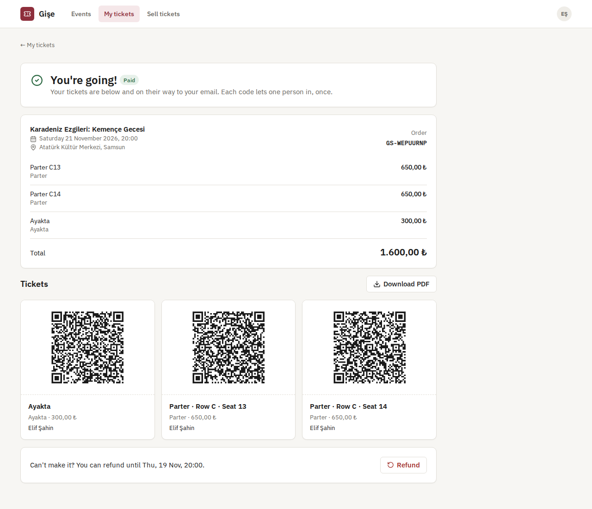 |
| **The waiting room** | **What's on** |
| 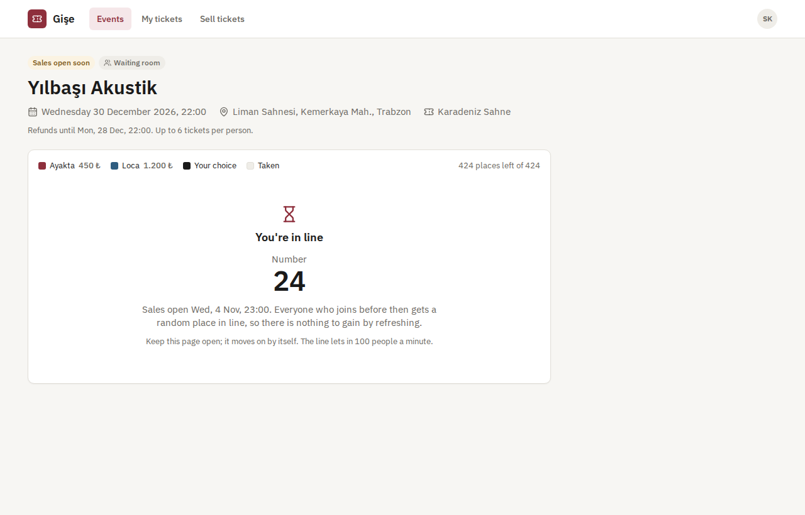 | 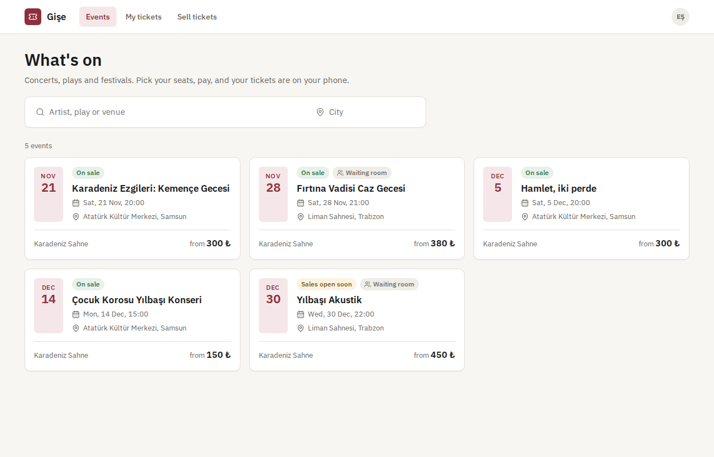 |
| **The organizer's dashboard** | **The gate, offline** |
| 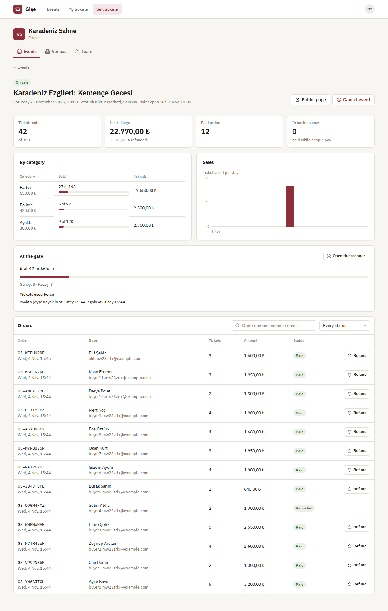 | 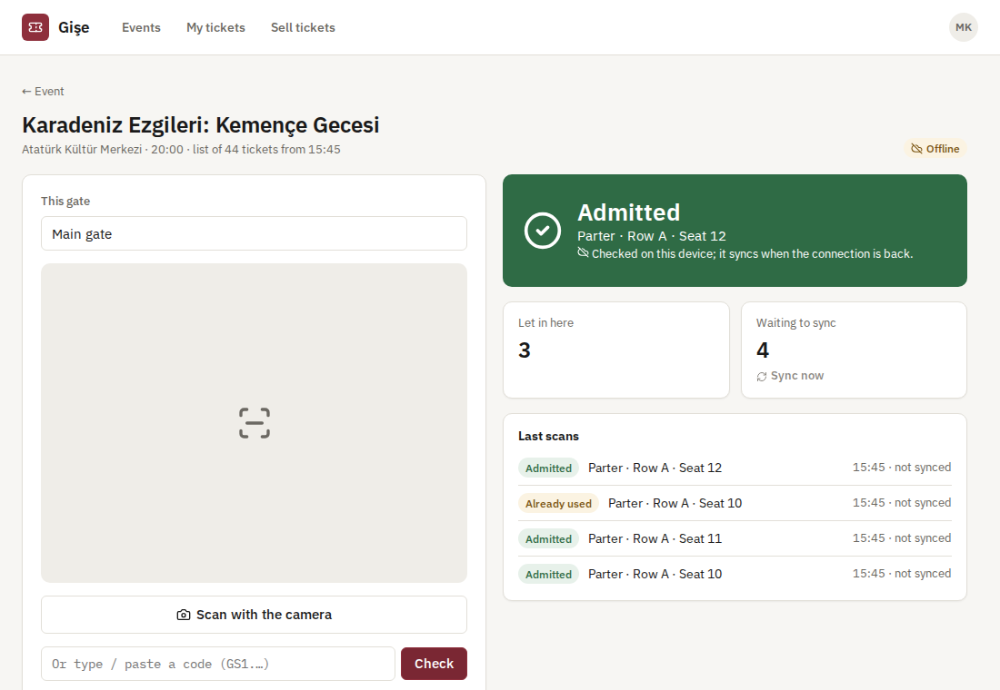 |
| **The floor plan editor** | **The tickets email in Mailpit** |
| 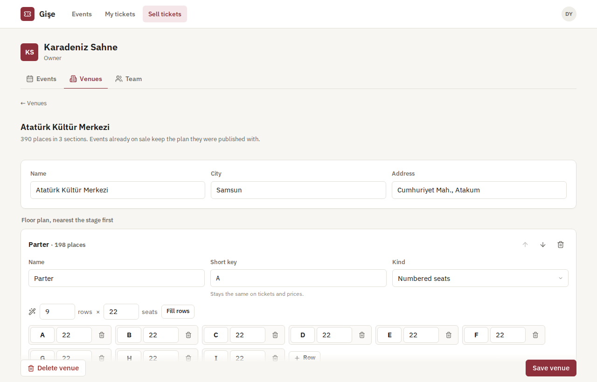 | 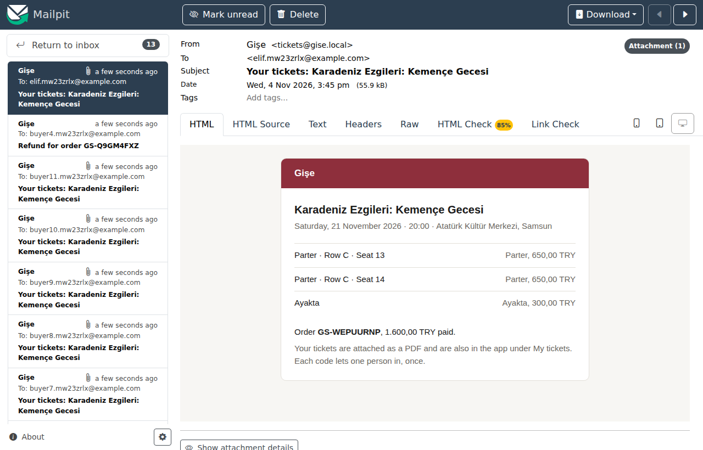 |
| **On a phone** | **API reference** |
| 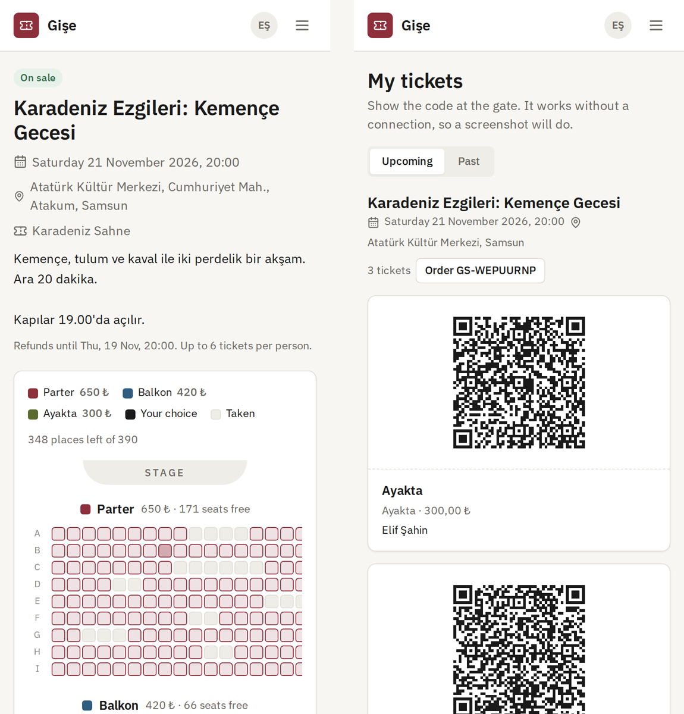 | 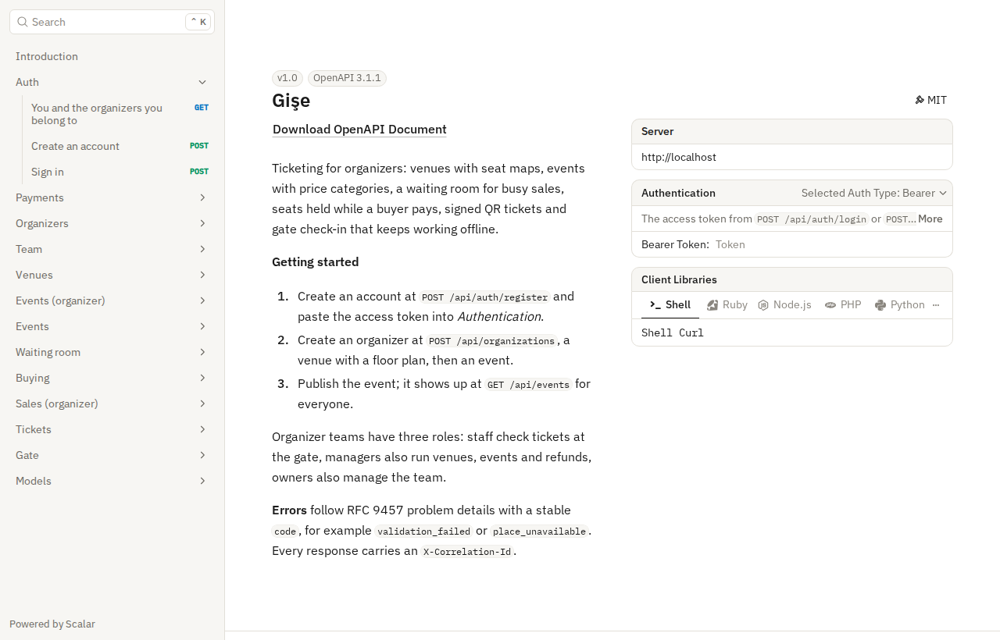 |

## Measured

`tests/load/load.mjs` plays a sale opening against the full Compose stack on a standard GitHub Actions runner (4 cores), with the load client on the same machine. The hall has 500 numbered seats and 200 standing places. 1,000 buyers arrive at once, 64 requests in flight at a time.

| Step | Result |
|---|---|
| Publishing the event (700 places written with COPY) | 41 ms |
| 1,000 buyers each ask for two neighbouring seats, 70% of them in the first five rows | 300 requests a second; p50 178 ms, p95 439 ms; 165 got their seats, 835 were told which seat was gone |
| Any seat held twice | none: 330 seats held, 330 different |
| The 835 others ask for one of the 200 standing places | exactly 200 got one, 635 were told it sold out; p50 137 ms, p95 210 ms |
| The seat map read 2,000 times during the sale | p50 22 ms, p95 40 ms, no errors |
| 365 checkouts | p50 54 ms, p95 200 ms |
| From "pay" on the provider's page to a paid order | p50 1.8 s, p95 3.1 s, all 365 settled |
| The books afterwards | 530 tickets sold + 170 places free = 700; net 215,000.00 TRY, the exact sum of the prices |
| Two gate devices sync 530 tickets each, in batches of 200 | every ticket admitted once and reported as used once at the other gate; about 4 ms per scan |
| 1,000 people join a waiting room before the sale | p50 115 ms, p95 199 ms; 1,000 different places in line |

What the numbers say:

- Nothing was sold twice, under the heaviest contention the test could make: most buyers wanted the same few rows.
- Losing a seat costs a buyer under half a second, and they hear which seat went, so the map can grey it out.
- The time to a paid order is mostly the stand-in provider, which delivers its webhooks one at a time, plus the test client checking the order every 100 ms.

## Tech stack

- ASP.NET Core 10: minimal APIs, ProblemDetails, OpenAPI with Scalar, JWT bearer, rate limiting, background services
- PostgreSQL 17: row locks, `SKIP LOCKED`, advisory locks, COPY; Entity Framework Core 10 and Npgsql
- ECDSA P-256 signatures (.NET and WebCrypto), QRCoder, PdfPig for the ticket PDF with IBM Plex embedded
- A stand-in payment provider (ASP.NET Core) with a hosted page, an API and HMAC-signed webhooks
- SMTP through an outbox; Mailpit locally
- React 18, TypeScript and Vite; jsQR for the camera, qrcode for tickets, a service worker for the offline gate; Lucide icons and IBM Plex; nginx
- xUnit, Testcontainers, Vitest, Playwright
- GitHub Actions: warnings as errors, .NET and web tests, pending-migration check, Compose smoke test, browser walkthrough
- Docker / Docker Compose

## Architecture

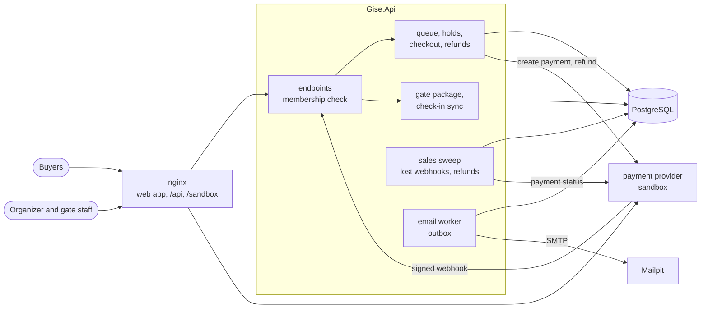

From choosing seats to a ticket at the gate:

```mermaid
sequenceDiagram
    participant B as Buyer
    participant A as API
    participant P as PostgreSQL
    participant V as Provider
    participant G as Gate device
    B->>A: POST /events/{id}/holds (seats C13, C14)
    A->>P: lock the seats in id order; take them only if free or their hold ran out
    A-->>B: 201 hold, 8 minutes (or 409: "C14 was taken a moment ago")
    B->>A: POST /holds/{id}/checkout
    A->>P: order; seats kept until the payment deadline
    A->>V: create payment (idempotency key)
    A-->>B: checkout URL
    B->>V: pays on the provider's page
    V->>A: webhook, HMAC-signed with a timestamp
    A->>P: record the notice once; seats sold; tickets issued; email queued
    G->>A: GET gate package (public key, ticket list)
    Note over G: offline: checks the signature itself
    G->>A: POST check-ins (backlog, scan ids from the device)
    A->>P: first scan wins; repeats reported
```

## Design decisions

- **Seats are rows, and every change is a conditional update.** Each seat and standing spot is a row. Taking places is one `UPDATE` that only touches rows that are free, or whose hold has run out, and reports how many it changed. If that is fewer than asked for, the transaction rolls back. A held seat comes back by itself when its time is up, without a cleanup job. The background sweep only tidies.
- **No deadlocks between buyers.** Chosen seats are locked in id order before they are updated, so two buyers who want overlapping seats wait for each other instead of deadlocking. Standing places are taken with `SKIP LOCKED`, so buyers never queue behind one another for interchangeable spots. One buyer's requests for one event are serialised with an advisory lock, so two tabs cannot both pass the ticket limit.
- **A fair waiting room without a second system.** A buyer's place in line is a number in PostgreSQL: random for early arrivals, seconds since opening for later ones, ties broken by a sequence. Their position is a count over an index, and who is let in follows from the clock and the pace. It needs no timers, no messages and no extra infrastructure, and the same rules are easy to explain to buyers.
- **The provider decides when money moved.** Coming back from the payment page proves nothing; only the signed webhook settles an order. The signature covers a timestamp, so an old notice replayed later is refused. Every notice is recorded in the same transaction that acts on it, so a notice delivered twice, or a webhook and a status check that both report one payment, change things once. Requests to the provider carry idempotency keys, so a retried checkout or refund never charges or refunds twice.
- **Late money is handled, not lost.** A payment can arrive after its deadline: a slow buyer, a lost webhook. If every seat is still free, the order is completed after all. If any was sold to someone else, the order is refunded, with a reason the buyer can read.
- **Tickets that check themselves.** A ticket code holds the ticket and event ids and an ECDSA signature: 37 bytes of payload, 64 of signature, base64url, about 140 characters. A gate device with only the public key can reject forged or altered codes offline. The ticket list adds names and seats and marks refunded tickets. A ticket bought after the list was downloaded still passes on its signature. Where a browser cannot check signatures (plain HTTP), the device falls back to the list.
- **Offline scans that sync honestly.** Every scan gets an id on the device, so syncing a backlog twice does no harm. The server takes scans in the order they were made, keeps the earliest as the check-in, and reports any later one as a repeat with where and when the ticket was first used. A device that let someone in offline learns afterwards if that ticket had been used elsewhere first.
- **Emails written with the change they report.** "Here are your tickets" and "your refund is on its way" are rows in an outbox, written in the same transaction as the payment or refund. A worker claims them with `SKIP LOCKED`, sends them, and retries with a growing pause. A paid order never goes without its email, and a rolled-back one never gets one.
- **A provider behind an interface.** `IPaymentGateway` and `IWebhookVerifier` are all the shop knows about payments. The sandbox provider in this repository behaves like a real one, with a hosted page, an API, signed webhooks and retries, so the whole flow runs locally and in CI with no account or keys.
- **Money in kuruş.** Prices and totals are whole numbers of kuruş, so sums are exact; they are formatted only for display.
- **Times in UTC.** Times are stored in UTC and shown in the event's time zone on tickets and emails (Europe/Istanbul by default), and in the viewer's own zone in the app.

## Commands

| Command | What it does |
|---|---|
| `docker compose up --build` | The whole app on http://localhost:8080, emails at http://localhost:8025 |
| `dotnet test` | .NET unit and integration tests (Docker needed for Testcontainers) |
| `cd web && npm install && npm test` | Web app unit tests |
| `cd web && npm run dev` | The web app with hot reload on http://localhost:5173, against the API on port 5600 and the sandbox on 5601 |
| `bash tests/smoke/buy.sh` | Publish, buy, pay, read the email, check in and refund against a running stack |
| `cd tests/e2e && npm install && node gise.mjs` | The browser walkthrough, against a stack started with `AUTH_ATTEMPTS_PER_MINUTE=1000` |
| `node tests/load/load.mjs 1000 64` | The sale-opening test, against a stack started with `AUTH_ATTEMPTS_PER_MINUTE=100000 HOLDS_PER_MINUTE=100000` |
| `dotnet ef migrations add <Name> --project src/Gise.Infrastructure --startup-project src/Gise.Api --output-dir Persistence/Migrations` | Add a migration |

Configuration for a local run, kept out of the repository:

```bash
dotnet user-secrets --project src/Gise.Api set "ConnectionStrings:Gise" "Host=localhost;Database=gise;Username=…;Password=…"
dotnet user-secrets --project src/Gise.Api set "Jwt:SigningKey" "<at least 32 characters>"
dotnet user-secrets --project src/Gise.Api set "Payments:ApiKey" "<shared with the sandbox>"
dotnet user-secrets --project src/Gise.Api set "Payments:WebhookSecret" "<shared with the sandbox>"
dotnet user-secrets --project src/Gise.PaymentSandbox set "Sandbox:ApiKey" "<the same>"
dotnet user-secrets --project src/Gise.PaymentSandbox set "Sandbox:WebhookSecret" "<the same>"
# In production, an ECDSA P-256 private key in PEM signs the tickets:
#   openssl ecparam -name prime256v1 -genkey -noout | openssl pkcs8 -topk8 -nocrypt
dotnet user-secrets --project src/Gise.Api set "Tickets:SigningKey" "$(cat ticket-key.pem)"
```

## Tests

158 tests and three runs against the whole stack: 58 .NET unit tests, 82 integration tests that run the real API against PostgreSQL in Testcontainers, 18 Vitest tests for the web app, a 13-step Playwright walkthrough, and a Compose smoke test, all in CI.

- **Teams, venues and events:** roles from staff to owner, outsiders unable to tell an organizer exists, the last owner kept, floor plans that cannot be sold refused with a reason, a 50,000-place stadium, drafts kept private, pricing for every section, four publish requests at once creating the places once, and a venue changed after publishing leaving the event as it was.
- **Holds under contention:** all-or-nothing seat requests that name the seat that went, 20 buyers on one seat and 60 on 40 standing places with no oversell, holds running out, a new basket replacing the old one, the ticket limit across orders, and sales that have not opened.
- **Waiting room:** random order for early arrivals, steady admission, arrival order afterwards with a wait estimate, shopping time running out and joining again at the back.
- **Payments:** forged, stale and unsigned webhooks refused, a notice delivered twice acted on once, a lost webhook made up for by asking the provider, late money either completing the order or refunded, a provider down at checkout or during a refund, a declined payment, cancellation refunding everyone, and the organizer's takings by category.
- **Tickets and the gate:** codes that read back and resist tampering or another key, a PDF in Turkish, emails with the PDF and retried after a refused send, voided tickets after refunds and cancellation, the gate package verified with only the public key, first scan wins, forged and other events' codes turned away, a backlog synced twice counted once, and two offline gates reported with the earliest scan kept.
- **Web app (Vitest):** offline ticket checks with WebCrypto (signature, list fallback, refunded and repeated tickets), the device's scan log, seat selection and prices, and formatting.
- **Browsers (CI):** an organizer creating a venue and publishing, a visitor choosing seats and being asked to sign up, holding, paying on the provider's page, three QR tickets, seats taken for everyone else, the dashboard, the gate online and offline with sync, a refund, the phone layout, and no script errors.

## Roadmap and known gaps

- Adapters for real providers (iyzico, Stripe) behind `IPaymentGateway`; today only the sandbox is wired up.
- A drawn seat map (curved rows, angled blocks) instead of rows in order.
- Passing a ticket to a friend, and names per ticket.
- Rotating the ticket signing key while tickets signed with the old one stay valid.
- Rate limits and the seat-map cache live in the API's memory; with several instances they would move to Redis.
- Text messages and push notifications through the [notification-service](https://github.com/Beratoguzhan620/notification-service).

## License

[MIT](LICENSE) · Berat Oğuzhan Turğut · [GitHub](https://github.com/Beratoguzhan620)
