# Gişe

[English](README.md) · **Türkçe**

Konser, tiyatro ve festivaller için biletleme; satışın açıldığı an düşünülerek yapıldı. Organizatörler mekânlarının oturma planını çizer ve etkinlikleri satışa açar. Alıcılar koltuklarını harita üzerinden seçer; seçilen koltuklar ödeme yapılırken birkaç dakika onlara ayrılır. Yoğun bir satış, insanları adil bir sırayla ve sabit hızla içeri alan bir bekleme odasıyla açılabilir. Ödeme sağlayıcının kendi sayfasında yapılır ve imzalı bir webhook ile kesinleşir. Biletler özel anahtarla imzalanmış QR kodlardır; kapı, internet olmadan da gerçek bileti sahtesinden ayırır. Çevrimdışı yapılan taramalar sonra senkronize edilir ve iki kapıda kullanılan bilet raporlanır.

[](https://github.com/Beratoguzhan620/gise/actions/workflows/ci.yml)


## Deneyin

```bash
docker compose up --build
```

Bu komut PostgreSQL'i, API'yi, deneme amaçlı bir ödeme sağlayıcısını, Mailpit'i ve web uygulamasıyla birlikte nginx'i başlatır. http://localhost:8080 adresini açıp bir hesap oluşturun. *Sell tickets* bölümünde bir organizatör ve bir mekân oluşturun; mekân formu örnek bir oturma planıyla gelir. Ardından bir etkinlik oluşturup yayınlayın. Başka bir tarayıcı penceresinden bilet alın. Ödeme sayfası deneme sağlayıcısına aittir: kart sormaz, yalnızca "öde" ya da "reddet" seçeneği sunar. PDF ekli bilet e-postası http://localhost:8025 adresindeki Mailpit'e düşer. Bilet kontrolü için etkinliğin *Gate* ekranını açın; bu ekran bağlantı kapalıyken de çalışır.

- API dokümantasyonu: http://localhost:8080/scalar
- Telefonda kamerayla tarama için HTTPS gerekir (tarayıcılar kamerayı ve imza doğrulamayı yalnızca güvenli sayfalarda açar). Bilgisayarda localhost yeterlidir; kod elle de yapıştırılabilir.

## Özellikler

- **Organizatörler ve ekipleri:** hesabı olan herkes bir organizatör oluşturabilir. Görevliler (Staff) kapıda bilet kontrol eder. Yöneticiler (Manager) bunun yanında mekânları, etkinlikleri, satışları ve iadeleri yönetir. Sahipler (Owner) ekibi de yönetir. Üyelik ve rol her istekte veritabanından okunur.
- **Mekânlar ve oturma planları:** sahneden itibaren sıralanan bölümler; numaralı koltuk sıraları ya da kapasitesi belli ayakta alanlar; toplam 50.000 yere kadar. Etkinlik, yayınlandığı anda planın bir kopyasını alır; mekân sonradan değişse de satılmış bir koltuk yerinden oynamaz.
- **Etkinlikler:** yalnızca ekibin gördüğü taslaklar; kuruş hassasiyetinde fiyat kategorileri; her bölüm için bir fiyat; belli bir saatte açılan satış; alıcı başına bilet sınırı; başlangıçtan belli bir süre öncesine kadar alıcının kendisinin yapabildiği iade ya da yalnızca organizatör üzerinden iade.
- **Asla fazla satmayan koltuk haritası:** alıcılar koltuk ya da belli sayıda ayakta yer seçer. İstenen yerlerin ya hepsi alınır ya hiçbiri; az önce başkasının aldığı koltuk adıyla bildirilir. Ayrılan yerler süre dolunca kendiliğinden satışa geri döner.
- **Bekleme odası:** dakikalar içinde tükenen satışlar için. Satış açılmadan gelen herkes sırada rastgele bir yer alır; doğru saniyede sayfayı yenilemek bir şey kazandırmaz. Daha sonra gelenler geliş sırasıyla dizilir. Sıra etkinliğin belirlediği hızda ilerler, herkese sıra numarasını ve bekleme süresini gösterir, sırası gelene de seçim yapması için belli bir süre tanır.
- **Ödemeler:** ödeme adımı siparişi oluşturur ve alıcıyı sağlayıcının sayfasına yönlendirir. Sipariş, sağlayıcının imzalı webhook'u ile kesinleşir; aynı bildirim iki kez gelse de bir kez işlenir. Bir webhook kaybolursa arka plandaki tarama sağlayıcıya sorar. Koltuklar başkasına satıldıktan sonra gelen ödeme otomatik olarak iade edilir. Sağlayıcı bir arayüzün arkasındadır; projeyle birlikte bir sandbox sağlayıcı gelir.
- **İade ve iptal:** alıcılar son iade tarihine kadar, organizatörler her zaman iade yapabilir. Etkinliği iptal etmek ödenmiş bütün siparişleri iade eder. Koltuklar hemen satışa döner ve biletler anında geçersiz olur; para, sağlayıcı onayladığında geri gider ve onaylanana kadar yeniden denenir.
- **Biletler:** her yer için bir bilet; ECDSA P-256 ile imzalanmış bir QR kod. Çevrimdışı da çalışan uygulamada gösterilir ve her bilete bir sayfa ayıran PDF ile e-postayla gönderilir. E-postalar bir outbox üzerinden gönderilir ve hata alırsa yeniden denenir.
- **Kapı:** cihaz etkinliğin açık anahtarını ve bilet listesini indirir; kodları kamerayla ya da elle, çevrimiçi ya da çevrimdışı kontrol eder. Çevrimdışı taramalar kuyruğa alınıp senkronize edilir. Bir biletin ilk taraması geçerli sayılır; tekrar taramalar ve farklı kapılarda iki kez içeri alınan biletler raporlanır. Organizatör kimin, hangi kapıdan girdiğini görür.
- **Organizatör paneli:** kategoriye göre satılan biletler, gelir ve iadeler, günlük satışlar, arama ve iade yapılabilen sipariş listesi, kapı özeti.
- **Web uygulaması:** React ve TypeScript. Etkinlik listesi, canlı sepetli koltuk haritası, bekleme odası, sipariş ve biletler, oturma planı düzenleyicisi olan organizatör alanı, kapı tarayıcısı. Her yerde boş, yükleniyor ve hata durumları; telefona uygun düzen.

## Ekran görüntüleri

| Koltuk haritası, üç yer seçili | Ödeme sırasında ayrılmış yerler |
|---|---|
| 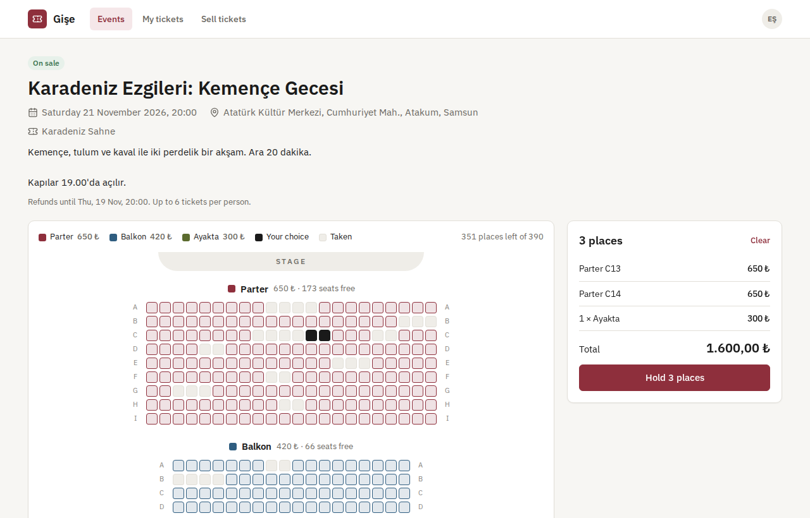 | 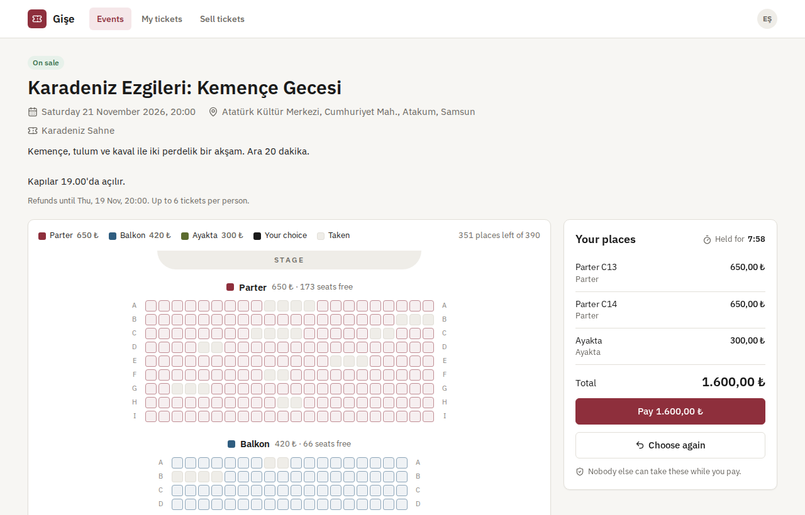 |
| **Sağlayıcının ödeme sayfası (sandbox)** | **Ödendi: biletler** |
| 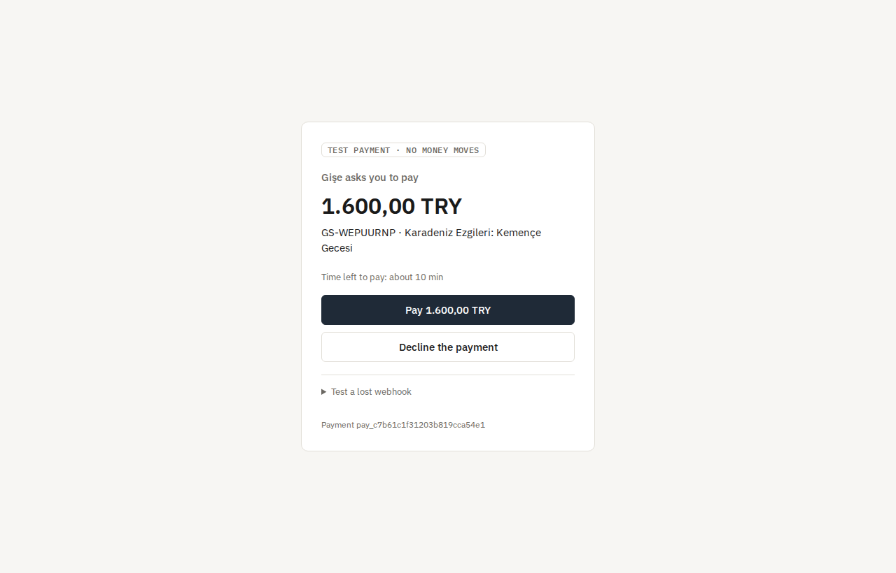 | 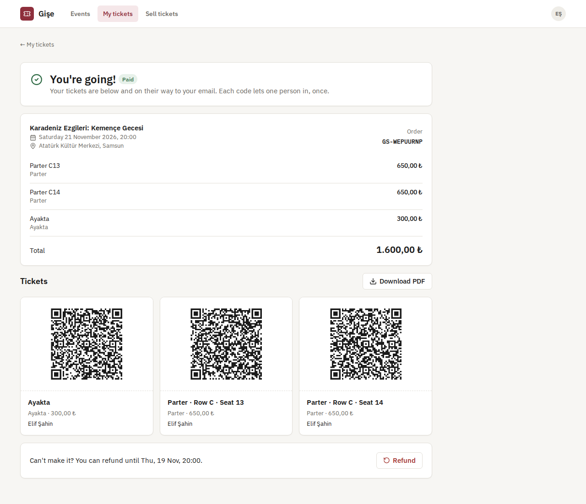 |
| **Bekleme odası** | **Etkinlikler** |
| 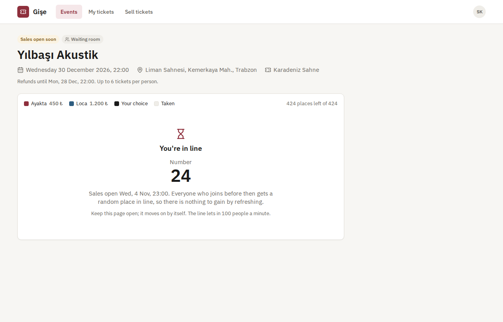 | 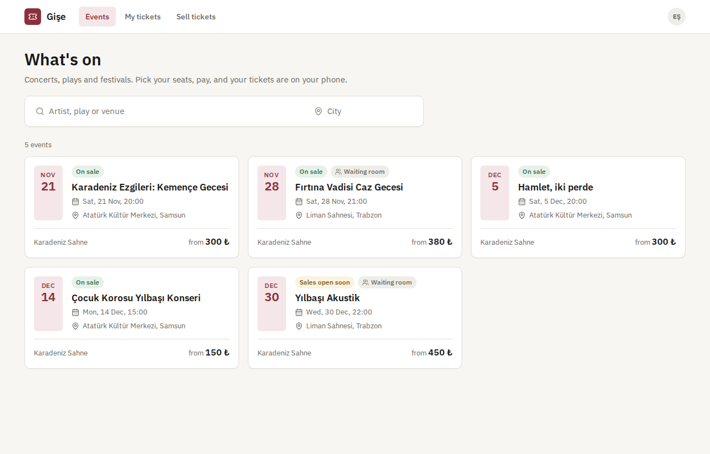 |
| **Organizatör paneli** | **Kapı, çevrimdışı** |
| 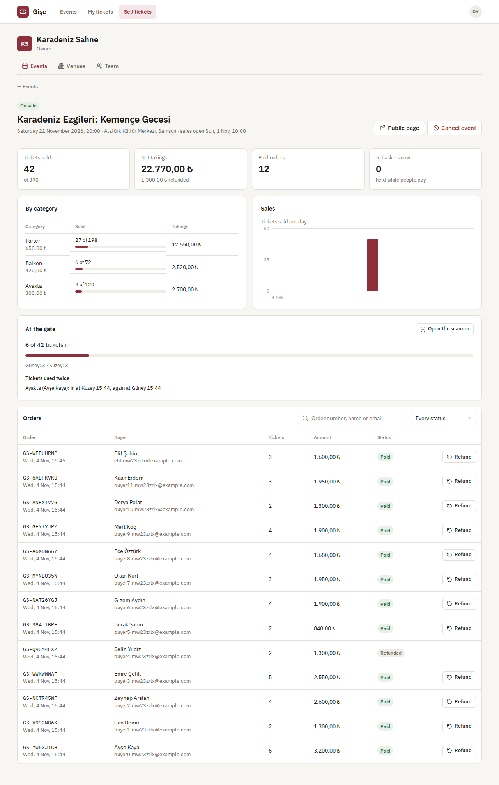 | 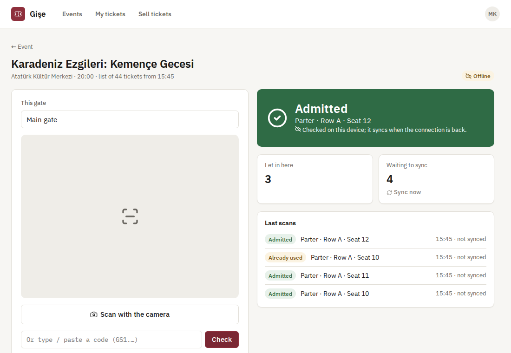 |
| **Oturma planı düzenleyicisi** | **Mailpit'te bilet e-postası** |
| 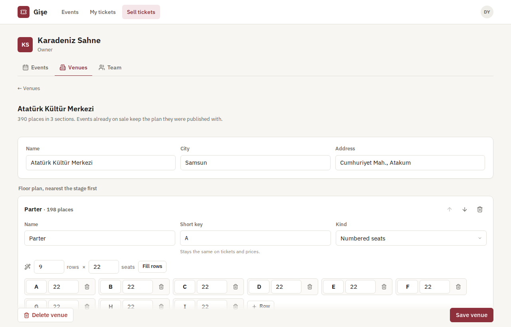 | 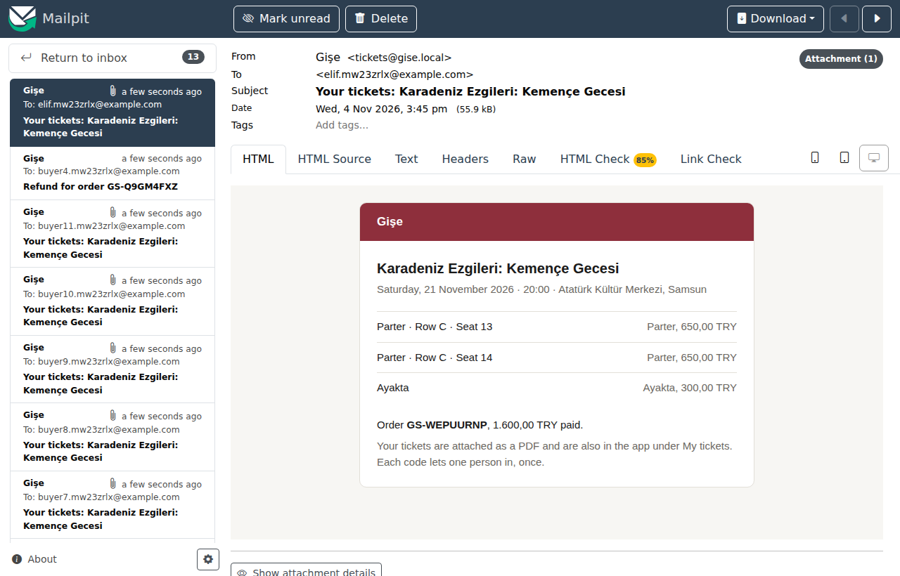 |
| **Telefonda** | **API dokümantasyonu** |
| 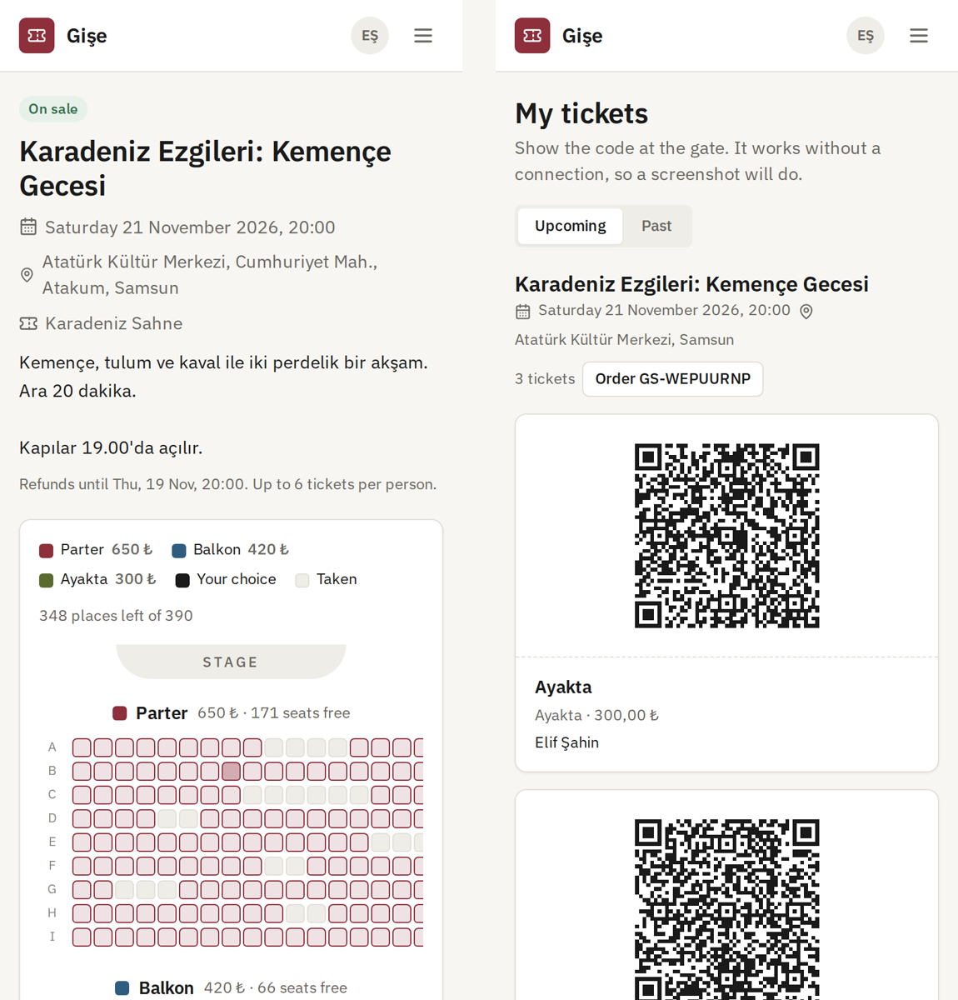 | 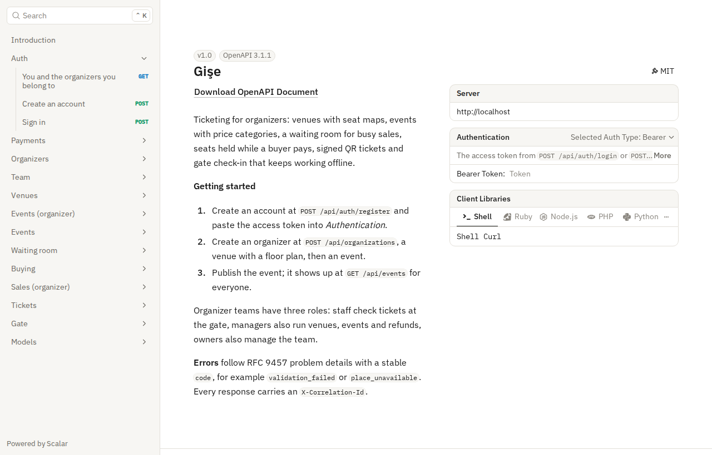 |

## Ölçümler

`tests/load/load.mjs`, standart bir GitHub Actions makinesinde (4 çekirdek) tam Compose ortamına karşı bir satışın açılışını canlandırır; yük istemcisi de aynı makinededir. Salonda 500 numaralı koltuk ve 200 ayakta yer vardır. 1.000 alıcı aynı anda gelir; aynı anda en fazla 64 istek gönderilir.

| Adım | Sonuç |
|---|---|
| Etkinliğin yayınlanması (700 yer COPY ile yazılır) | 41 ms |
| 1.000 alıcının her biri yan yana iki koltuk ister; %70'i ilk beş sıradan | saniyede 300 istek; p50 178 ms, p95 439 ms; 165 alıcı koltuklarını aldı, 835'ine hangi koltuğun gittiği söylendi |
| İki kez ayrılan koltuk | yok: 330 koltuk ayrıldı, 330'u da farklı |
| Kalan 835 kişi 200 ayakta yerden birini ister | tam 200'ü aldı, 635'ine tükendiği söylendi; p50 137 ms, p95 210 ms |
| Satış sırasında koltuk haritası 2.000 kez okundu | p50 22 ms, p95 40 ms, hata yok |
| 365 ödeme adımı | p50 54 ms, p95 200 ms |
| Sağlayıcı sayfasında "öde"den ödenmiş siparişe | p50 1,8 sn, p95 3,1 sn; 365'inin hepsi kesinleşti |
| Sonrasında hesaplar | 530 bilet satıldı + 170 yer boş = 700; net 215.000,00 TL, fiyatların tam toplamı |
| İki kapı cihazı 530'ar bileti 200'lük paketlerle senkronize eder | her bilet bir kez içeri alındı, diğer kapıda bir kez "kullanılmış" olarak raporlandı; tarama başına yaklaşık 4 ms |
| Satış açılmadan 1.000 kişi bekleme odasına girer | p50 115 ms, p95 199 ms; sırada 1.000 farklı yer |

Rakamların söyledikleri:

- Testin yaratabildiği en yoğun çakışmada bile hiçbir şey iki kez satılmadı: alıcıların çoğu aynı birkaç sırayı istiyordu.
- Koltuğu kaçırmak alıcıya yarım saniyeden kısa sürer ve hangi koltuğun gittiğini öğrenir; harita o koltuğu gri gösterebilir.
- Ödenmiş siparişe kadar geçen sürenin çoğu, webhook'larını tek tek gönderen deneme sağlayıcısından ve siparişi 100 ms'de bir kontrol eden test istemcisinden kaynaklanır.

## Kullanılan teknolojiler

- ASP.NET Core 10: minimal API'ler, ProblemDetails, Scalar ile OpenAPI, JWT bearer, rate limiting, arka plan servisleri
- PostgreSQL 17: satır kilitleri, `SKIP LOCKED`, advisory kilitler, COPY; Entity Framework Core 10 ve Npgsql
- ECDSA P-256 imzaları (.NET ve WebCrypto), QRCoder, IBM Plex gömülü bilet PDF'i için PdfPig
- Barındırılan sayfası, API'si ve HMAC imzalı webhook'ları olan deneme ödeme sağlayıcısı (ASP.NET Core)
- Outbox üzerinden SMTP; yerelde Mailpit
- React 18, TypeScript ve Vite; kamera için jsQR, biletler için qrcode, çevrimdışı kapı için service worker; Lucide ikonları ve IBM Plex; nginx
- xUnit, Testcontainers, Vitest, Playwright
- GitHub Actions: uyarılar hata sayılır, .NET ve web testleri, eksik migration kontrolü, Compose smoke testi, tarayıcı testi
- Docker / Docker Compose

## Mimari

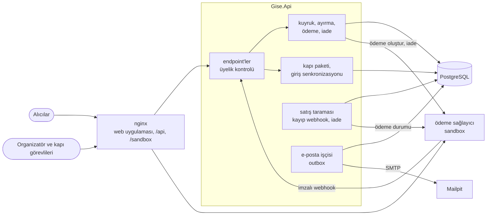

Koltuk seçiminden kapıdaki bilete:

```mermaid
sequenceDiagram
    participant B as Alıcı
    participant A as API
    participant P as PostgreSQL
    participant V as Sağlayıcı
    participant G as Kapı cihazı
    B->>A: POST /events/{id}/holds (C13, C14)
    A->>P: koltukları id sırasıyla kilitle; yalnızca boşsa ya da ayırma süresi dolmuşsa al
    A-->>B: 201 ayırma, 8 dakika (ya da 409: "C14 az önce alındı")
    B->>A: POST /holds/{id}/checkout
    A->>P: sipariş; koltuklar ödeme süresi bitene kadar tutulur
    A->>V: ödeme oluştur (idempotency anahtarı)
    A-->>B: ödeme sayfasının adresi
    B->>V: sağlayıcının sayfasında öder
    V->>A: webhook, zaman damgalı HMAC imzasıyla
    A->>P: bildirimi bir kez kaydet; koltuklar satıldı; biletler düzenlendi; e-posta kuyruğa alındı
    G->>A: GET kapı paketi (açık anahtar, bilet listesi)
    Note over G: çevrimdışıyken imzayı kendisi doğrular
    G->>A: POST check-ins (birikmiş taramalar, cihazın verdiği tarama id'leri)
    A->>P: ilk tarama geçerli; tekrarlar raporlanır
```

## Tasarım kararları

- **Koltuklar birer satırdır ve her değişiklik koşullu bir güncellemedir.** Her koltuk ve ayakta yer bir satırdır. Yer almak tek bir `UPDATE`'tir: yalnızca boş olan ya da ayırma süresi dolmuş satırlara dokunur ve kaç satırı değiştirdiğini söyler. İstenenden azsa işlem geri alınır. Ayrılan bir koltuk süresi dolunca temizlik işine gerek kalmadan kendiliğinden geri döner; arka plan taraması yalnızca düzen sağlar.
- **Alıcılar arasında deadlock yok.** Seçilen koltuklar güncellenmeden önce id sırasıyla kilitlenir; çakışan koltuklar isteyen iki alıcı birbirini kilitlemek yerine sırayla bekler. Ayakta yerler `SKIP LOCKED` ile alınır; birbirinin yerine geçebilen yerler için kimse kimseyi beklemez. Bir alıcının aynı etkinlik için gönderdiği istekler advisory lock ile sıraya konur; iki sekme bilet sınırını birlikte aşamaz.
- **İkinci bir sistem olmadan adil bekleme odası.** Alıcının sıradaki yeri PostgreSQL'de bir sayıdır: erken gelenler için rastgele, sonradan gelenler için açılıştan bu yana geçen saniye; eşitlikleri bir sequence bozar. Sıra numarası bir indeks üzerinden yapılan sayımdır; kimin içeri alınacağı saatten ve hızdan hesaplanır. Zamanlayıcı, mesaj ya da ek altyapı gerekmez; aynı kurallar alıcıya da kolayca anlatılır.
- **Paranın geçtiğine sağlayıcı karar verir.** Ödeme sayfasından geri dönmek hiçbir şey kanıtlamaz; siparişi yalnızca imzalı webhook kesinleştirir. İmza bir zaman damgasını da kapsar; eski bir bildirim sonradan tekrar gönderilirse reddedilir. Her bildirim, onu işleyen işlemin içinde kaydedilir. İki kez gelen bir bildirim ya da aynı ödemeyi bildiren bir webhook ile bir durum sorgusu, değişikliği yalnızca bir kez yapar. Sağlayıcıya giden isteklerde idempotency anahtarı vardır; yeniden denenen bir ödeme ya da iade asla iki kez çekim ya da iade yapmaz.
- **Geç gelen para kaybolmaz, yönetilir.** Ödeme, süresi geçtikten sonra gelebilir: yavaş bir alıcı ya da kaybolan bir webhook. Koltukların hepsi hâlâ boşsa sipariş yine de tamamlanır. Biri başkasına satılmışsa sipariş, alıcının okuyabileceği bir gerekçeyle iade edilir.
- **Kendini doğrulayan biletler.** Bilet kodu, bilet ve etkinlik id'lerini ve bir ECDSA imzasını taşır: 37 bayt veri, 64 bayt imza, base64url ile yaklaşık 140 karakter. Elinde yalnızca açık anahtar olan bir kapı cihazı, sahte ya da değiştirilmiş kodları çevrimdışı reddedebilir. Bilet listesi isimleri ve koltukları ekler, iade edilen biletleri işaretler. Liste indirildikten sonra alınan bir bilet de imzasıyla geçer. Tarayıcının imza doğrulayamadığı yerlerde (düz HTTP) cihaz listeye göre karar verir.
- **Dürüstçe senkronize olan çevrimdışı taramalar.** Her tarama cihazda bir id alır; birikmiş taramaları iki kez göndermek zarar vermez. Sunucu taramaları yapıldıkları sırayla işler, en erkenini giriş olarak tutar ve sonrakileri, biletin ilk nerede ve ne zaman kullanıldığıyla birlikte tekrar olarak raporlar. Çevrimdışıyken birini içeri alan cihaz, o biletin daha önce başka bir kapıda kullanılıp kullanılmadığını sonradan öğrenir.
- **E-postalar bildirdikleri değişiklikle birlikte yazılır.** "Biletleriniz burada" ve "iadeniz yolda" e-postaları bir outbox tablosundaki satırlardır; ödeme ya da iadeyle aynı işlemde yazılır. Bir işçi bu satırları `SKIP LOCKED` ile alır, gönderir ve giderek uzayan aralıklarla yeniden dener. Ödenmiş hiçbir sipariş e-postasız kalmaz, geri alınmış bir sipariş de e-posta almaz.
- **Arayüzün arkasında bir sağlayıcı.** Mağazanın ödemelerle ilgili bildiği tek şey `IPaymentGateway` ve `IWebhookVerifier` arayüzleridir. Bu depodaki sandbox sağlayıcı gerçek bir sağlayıcı gibi davranır: barındırılan bir sayfası, bir API'si, imzalı webhook'ları ve yeniden denemeleri vardır. Böylece akışın tamamı yerelde ve CI'da hesap ya da anahtar olmadan çalışır.
- **Para kuruş cinsinden.** Fiyatlar ve toplamlar tam sayı kuruştur; toplamlar kesindir, biçimlendirme yalnızca gösterirken yapılır.
- **Zamanlar UTC olarak.** Zamanlar UTC olarak saklanır. Bilet ve e-postalarda etkinliğin saat diliminde (varsayılan Europe/Istanbul), uygulamada ise bakan kişinin kendi saat diliminde gösterilir.

## Komutlar

| Komut | Ne yapar |
|---|---|
| `docker compose up --build` | Uygulamanın tamamı http://localhost:8080 adresinde, e-postalar http://localhost:8025 adresinde |
| `dotnet test` | .NET birim ve entegrasyon testleri (Testcontainers için Docker gerekir) |
| `cd web && npm install && npm test` | Web uygulamasının birim testleri |
| `cd web && npm run dev` | 5600 portundaki API'ye ve 5601'deki sandbox'a bağlı, http://localhost:5173 adresinde anında yenilenen web uygulaması |
| `bash tests/smoke/buy.sh` | Çalışan ortamda yayınla, satın al, öde, e-postayı oku, giriş yap ve iade et |
| `cd tests/e2e && npm install && node gise.mjs` | `AUTH_ATTEMPTS_PER_MINUTE=1000` ile başlatılmış ortama karşı tarayıcı testi |
| `node tests/load/load.mjs 1000 64` | `AUTH_ATTEMPTS_PER_MINUTE=100000 HOLDS_PER_MINUTE=100000` ile başlatılmış ortama karşı satış açılışı testi |
| `dotnet ef migrations add <Ad> --project src/Gise.Infrastructure --startup-project src/Gise.Api --output-dir Persistence/Migrations` | Migration ekler |

Yerel çalıştırma ayarları, depoda tutulmaz:

```bash
dotnet user-secrets --project src/Gise.Api set "ConnectionStrings:Gise" "Host=localhost;Database=gise;Username=…;Password=…"
dotnet user-secrets --project src/Gise.Api set "Jwt:SigningKey" "<en az 32 karakter>"
dotnet user-secrets --project src/Gise.Api set "Payments:ApiKey" "<sandbox ile ortak>"
dotnet user-secrets --project src/Gise.Api set "Payments:WebhookSecret" "<sandbox ile ortak>"
dotnet user-secrets --project src/Gise.PaymentSandbox set "Sandbox:ApiKey" "<aynısı>"
dotnet user-secrets --project src/Gise.PaymentSandbox set "Sandbox:WebhookSecret" "<aynısı>"
# Canlı ortamda biletleri PEM biçiminde bir ECDSA P-256 özel anahtarı imzalar:
#   openssl ecparam -name prime256v1 -genkey -noout | openssl pkcs8 -topk8 -nocrypt
dotnet user-secrets --project src/Gise.Api set "Tickets:SigningKey" "$(cat ticket-key.pem)"
```

## Testler

158 test ve tam ortama karşı üç çalıştırma: 58 .NET birim testi; gerçek API'yi Testcontainers içindeki PostgreSQL'e karşı çalıştıran 82 entegrasyon testi; web uygulaması için 18 Vitest testi; 13 adımlı bir Playwright tarayıcı testi ve bir Compose smoke testi. Hepsi CI'da çalışır.

- **Ekipler, mekânlar ve etkinlikler:** görevliden sahibe roller; dışarıdan birinin bir organizatörün varlığını anlayamaması; son sahibin korunması; satılamayacak oturma planlarının gerekçesiyle reddi; 50.000 kişilik bir stadyum; gizli kalan taslaklar; her bölümün fiyatlandırılması; aynı anda gelen dört yayınlama isteğinin yerleri yalnızca bir kez oluşturması; yayından sonra değişen mekânın etkinliği etkilememesi.
- **Çakışma altında ayırma:** ya hepsi ya hiçbiri mantığıyla çalışan ve giden koltuğu adıyla söyleyen koltuk istekleri; tek koltuğa 20 alıcı ve 40 ayakta yere 60 alıcı ile fazla satış olmaması; süresi dolan ayırmalar; eskisinin yerine geçen yeni sepet; siparişler arasında geçerli bilet sınırı; henüz açılmamış satışlar.
- **Bekleme odası:** erken gelenler için rastgele sıra, sabit hızla içeri alma, sonrasında geliş sırası ve bekleme tahmini, seçim süresinin dolması ve sıranın sonuna yeniden girme.
- **Ödemeler:** sahte, eski ve imzasız webhook'ların reddi; iki kez gelen bildirimin bir kez işlenmesi; kaybolan webhook'un sağlayıcıya sorularak telafisi; geç gelen paranın siparişi tamamlaması ya da iade edilmesi; ödeme ya da iade sırasında sağlayıcının erişilemez olması; reddedilen ödeme; iptalin herkesi iade etmesi; organizatörün kategoriye göre geliri.
- **Biletler ve kapı:** geri okunabilen ve değiştirmeye ya da başka bir anahtara karşı dayanıklı kodlar; Türkçe PDF; PDF ekli ve reddedilince yeniden denenen e-postalar; iade ve iptal sonrası geçersiz biletler; yalnızca açık anahtarla doğrulanan kapı paketi; ilk taramanın geçerli olması; sahte ve başka etkinliklere ait kodların reddi; iki kez gönderilen birikmiş taramaların bir kez sayılması; çevrimdışı iki kapının en erken taramayı koruyarak raporlanması.
- **Web uygulaması (Vitest):** WebCrypto ile çevrimdışı bilet kontrolü (imza, listeye dayanan yedek yol, iade edilmiş ve tekrar taranan biletler), cihazın tarama kaydı, koltuk seçimi ve fiyatlar, biçimlendirme.
- **Tarayıcılar (CI):** organizatörün mekân oluşturup yayınlaması; ziyaretçinin koltuk seçip kayıt olmaya yönlendirilmesi; ayırma; sağlayıcının sayfasında ödeme; üç QR bilet; koltukların herkese dolu görünmesi; panel; çevrimiçi ve çevrimdışı kapı ile senkronizasyon; iade; telefon düzeni; script hatası olmaması.

## Yol haritası ve bilinen eksikler

- `IPaymentGateway` arkasında gerçek sağlayıcılar (iyzico, Stripe) için adaptörler; şu an yalnızca sandbox bağlı.
- Sıralı bölümler yerine çizilebilen bir koltuk haritası (kavisli sıralar, açılı bloklar).
- Bileti bir arkadaşa devretmek ve bilet başına isim.
- Eski anahtarla imzalanmış biletler geçerli kalırken bilet imzalama anahtarını değiştirebilmek.
- Rate limit sayaçları ve koltuk haritası önbelleği API'nin belleğinde; birden çok örnekle Redis'e taşınmalı.
- [notification-service](https://github.com/Beratoguzhan620/notification-service) üzerinden SMS ve push bildirimleri.

## Lisans

[MIT](LICENSE) · Berat Oğuzhan Turğut · [GitHub](https://github.com/Beratoguzhan620)
